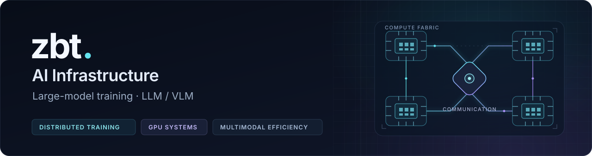

  

关注 **大模型训练基础设施**：分布式并行、GPU 性能，以及 LLM / VLM 的训练效率。

把系统问题拆清楚，把性能收益测明白。数据库与分布式系统仍是我的技术底色。

### Current focus / 训练系统

| 方向 | 最近关注的项目 | 想弄清楚的问题 |
| :--- | :--- | :--- |
| **Scale training** | [Megatron-LM](https://github.com/NVIDIA/Megatron-LM) · [torchtitan](https://github.com/pytorch/torchtitan) | 并行策略、训练栈与规模化效率 |
| **Compute & communication** | [MagiAttention](https://github.com/SandAI-org/MagiAttention) · [DeepEP](https://github.com/deepseek-ai/DeepEP) · [TransformerEngine](https://github.com/NVIDIA/TransformerEngine) · [CUTLASS](https://github.com/NVIDIA/cutlass) | 长上下文注意力、通信、算子与低精度 |
| **RL post-training** | [slime](https://github.com/THUDM/slime) · [verl](https://github.com/verl-project/verl) | RL 扩展、训练与 rollout 协作 |
| **Multimodal efficiency** | [RLT](https://github.com/rccchoudhury/rlt) | 视频冗余、词元压缩与训练加速 |

### Recent work / 近期实践

**[slime · GPU 训练环境适配](https://github.com/zbtzbtzbt/slime/commit/1c00330558080b21f99a3d57fb5aeabadeda6d7e)**

在自己的 fork 中改进环境构建，处理 CUDA 扩展、FlashAttention 和动态库兼容性。`fork patch` · 2026-10

### Languages & tools / 技术方向

<!-- PUBLIC-SIGNALS:START -->

### Building forward / 接下来

继续深入训练系统，开展 GPU 性能实验，整理 LLM / VLM 论文解析；用可复核的实现与实验记录持续进展。

<!-- PUBLIC-SIGNALS:END -->

从系统问题出发，留下可复现的实验、工程记录与论文理解。
